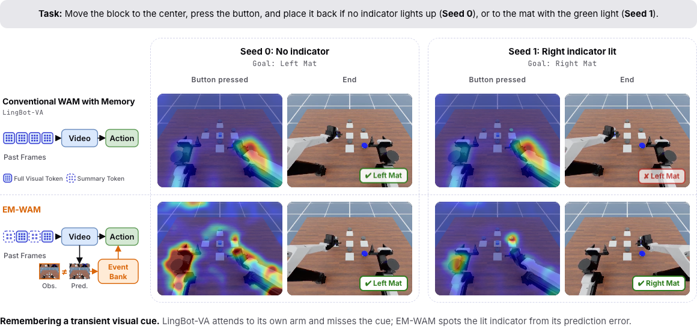

<div align="center">

# Endogenous and Exogenous Memory for World Action Models

[Zerui Gong](https://scholar.google.com/citations?user=sjiwhzcAAAAJ)<sup>1*</sup>, [Marina Barannikov](https://marinabarannikov.github.io/)<sup>2*</sup>, [Zhonghua Wu](https://wu-zhonghua.github.io/)<sup>1*†</sup>, Shanshan Lu<sup>2</sup>, [Junjie Gao](https://scholar.google.com/citations?user=av11S3sAAAAJ)<sup>1</sup>, [Zhe Yang](https://savannah-yz.github.io/)<sup>2</sup>, Jinglin He<sup>1</sup>, [Quanzhou Li](https://quanzhou-li.github.io/)<sup>2</sup>, Weijie Qiao<sup>1,2</sup>, [Qinyue Li](https://www.linkedin.com/in/dienachtderwelt/)<sup>1</sup>, [Qingyi Tao](https://truetqy.github.io/)<sup>1</sup>, [Chen Change Loy](https://www.mmlab-ntu.com/person/ccloy/)<sup>2,3</sup>

<sup>1</sup>SenseTime Research, Singapore &nbsp;&nbsp; <sup>2</sup>S-Lab, Nanyang Technological University &nbsp;&nbsp; <sup>3</sup>ACE Robotics

<sup>*</sup>Equal contribution &nbsp;&nbsp; <sup>†</sup>Project lead

[](https://pawteam-eai.github.io/em-wam/)
[](https://pawteam-eai.github.io/em-wam/#video)

</div>

<p align="center">
  <a href="https://pawteam-eai.github.io/em-wam/#teaser">
    
  </a>
</p>

## Abstract

A robot may have to act on a cue long after it disappears. **EM-WAM** equips a world action model with two complementary memories, both driven by its video expert without additional supervision. **Endogenous memory** tracks task progress. It keeps informative observations in full and compresses the remaining frames into a few visual tokens. **Exogenous memory** records unexpected local changes where the observed scene differs from the model’s prediction. The action expert can use that record after the event is over.

We introduce **RMBench-Dynamic**, eight dual-arm manipulation tasks in which an unexpected event changes what the robot needs to remember. EM-WAM achieves **58.8%** success on RMBench-Dynamic and **81.7%** on RMBench. On a real robot, it succeeds in **57 of 60 trials** across two tasks.

## News

- **November 2026** — The [project page](https://pawteam-eai.github.io/em-wam/) is live with interactive memory visualizations, benchmark tasks, and real-robot rollouts.

## Code, models, and dataset

Coming soon. Model and dataset releases will appear in the [EM-WAM Hugging Face collection](https://huggingface.co/collections/zrgong/em-wam-6b07e421b14d1c8e0abc50db).

## Citation

```bibtex
@misc{gong2026emwam,
  title  = {Endogenous and Exogenous Memory for World Action Models},
  author = {Gong, Zerui and Barannikov, Marina and Wu, Zhonghua and Lu, Shanshan and Gao, Junjie and Yang, Zhe and He, Jinglin and Li, Quanzhou and Qiao, Weijie and Li, Qinyue and Tao, Qingyi and Loy, Chen Change},
  year   = {2026},
  url    = {https://pawteam-eai.github.io/em-wam/}
}
```
